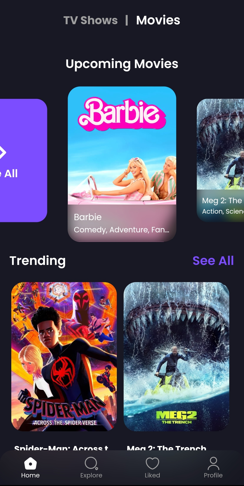
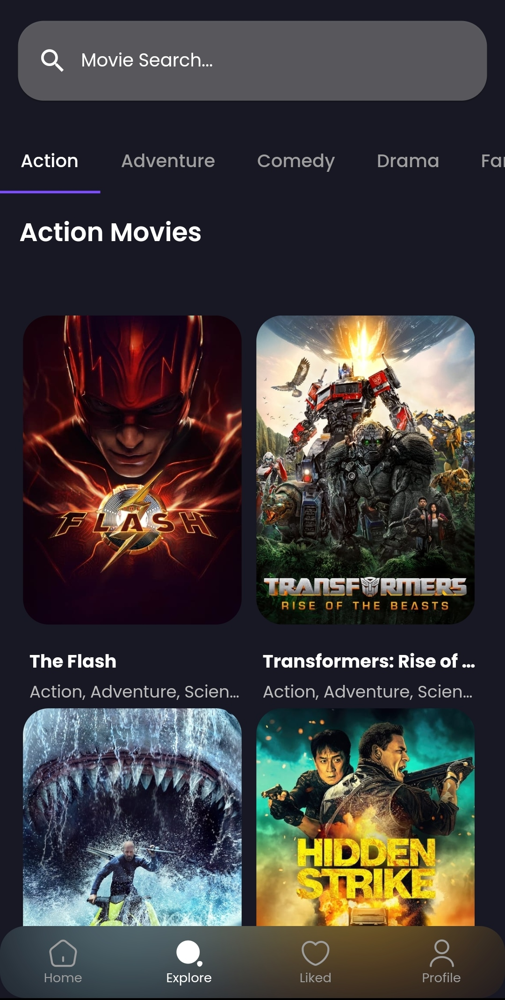
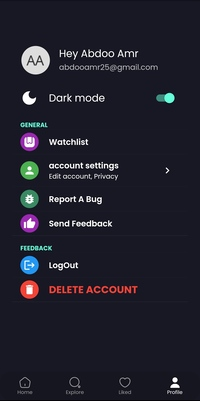

# Movie Night App

## Overview

Movie Night is a Flutter app that allows users to explore and discover the latest movies and TV shows. It utilizes the TMDb API (The Movie Database) to fetch information about movies and TV shows, providing users with a comprehensive library of entertainment options.

## Features

- **Latest Content:** Stay updated with the latest movies and TV shows.
- **Library:** Explore a vast library of movies and TV shows with detailed information.
- **Search:** Find specific movies or TV shows using the search functionality.
- **Favorites:** Save your favorite movies and TV shows for quick access.

## Screenshots






## Getting Started

### Prerequisites

- Flutter installed on your machine. [Flutter Installation Guide](https://flutter.dev/docs/get-started/install)
- TMDb API key. Get your API key from [TMDb Developer](https://www.themoviedb.org/documentation/api).

### Configuration

1. Clone the repository:

   ```bash
   git clone https://github.com/your-username/movie-night.git
   ```


2. Create `env.json` in the project root by copying the template:

   ```bash
   cp env.example.json env.json
   ```

   Then paste your TMDb **v3 API key** into it:

   ```json
   {
     "TMDB_API_KEY": "your_tmdb_v3_api_key_here"
   }
   ```

   `env.json` is gitignored — never commit it. The key is read at build time
   via `String.fromEnvironment('TMDB_API_KEY')` in
   `lib/src/services/services.dart`.

3. Install dependencies:

   ```bash
   flutter pub get
   ```

4. Run the app — the `--dart-define-from-file` flag is **required**:

   ```bash
   flutter run --dart-define-from-file=env.json
   ```

   Same flag for builds:

   ```bash
   flutter build apk --release --dart-define-from-file=env.json
   ```

   **VS Code:** just press F5 — `.vscode/launch.json` already passes the flag.

   **Android Studio / IntelliJ:** Run > Edit Configurations > Additional run
   args > `--dart-define-from-file=env.json`

   If the key is missing or wrong, every TMDb request returns 401 and the app
   shows empty lists.

## Contributing

We welcome contributions to enhance the Movie Night app. If you'd like to contribute, please follow these steps:

1. Fork the repository.
2. Create a new branch for your feature: `git checkout -b feature-name`.
3. Make your changes and commit them: `git commit -m 'Add feature'`.
4. Push to the branch: `git push origin feature-name`.
5. Create a pull request.

Please make sure to follow the [Flutter Style Guide](https://flutter.dev/docs/development/code-style) and provide detailed information in your pull request.

## License

This project is licensed under the MIT License - see the [LICENSE](LICENSE) file for details.

## Acknowledgments

- The Movie Database (TMDb) for providing the API.
- Flutter and Dart communities for creating an amazing framework.

Happy coding and enjoy your Movie Night! 🍿🎬
